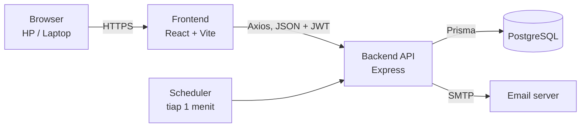

# 02 — Arsitektur Sistem

## 1. Gambaran besar

Aplikasi dipecah jadi dua bagian yang berjalan terpisah: **frontend** (yang dibuka di browser) dan **backend API** (yang menyimpan data dan menjalankan aturan bisnis). Keduanya berkomunikasi lewat HTTP dengan format JSON.



Kenapa dipisah, bukan satu aplikasi?

- Aturan penting (harga, poin, status) **harus** dijalankan di server. Kalau dihitung di browser, user bisa mengubahnya.
- Frontend bisa diganti/ditambah (misal aplikasi mobile) tanpa mengubah backend.
- Lebih mudah dites: logika bisnis di backend bisa diuji tanpa membuka browser.

## 2. Teknologi yang dipakai

| Bagian | Teknologi | Alasan |
|---|---|---|
| Frontend | React + Vite | React untuk UI berbasis komponen, Vite karena dev server dan build-nya cepat |
| Styling | TailwindCSS | Responsif cukup dengan class `sm:` `md:` `lg:` tanpa menulis CSS terpisah |
| HTTP client | Axios | Bisa memasang token JWT otomatis lewat *interceptor* |
| Backend | Node.js + Express.js | Ringan, satu bahasa (JavaScript) dengan frontend |
| Database | PostgreSQL | Relasional, mendukung SQL transaction dan constraint (unik, foreign key) |
| ORM | Prisma | Skema database ditulis sebagai kode, ada migrasi, dan `$transaction` untuk SQL transaction |
| Testing | Jest (+ Supertest) | Unit test untuk service dan test endpoint API |
| Container | Docker | Menjalankan PostgreSQL di laptop tanpa install, dan membungkus aplikasi untuk deploy |
| Version control | Git + GitHub | Riwayat kode dan tempat publish |

Library kecil pendukung: `react-router-dom` (routing halaman), `jsonwebtoken` (token login), `bcrypt` (hash password), `multer` (terima upload file), `nodemailer` (kirim email), `zod` (validasi input).

## 3. Struktur folder

Satu repository berisi dua aplikasi (*monorepo* sederhana):

```
gelar/
├── docs/                  ← dokumen analisis & desain (folder ini)
├── api/                   ← backend
│   ├── prisma/
│   │   ├── schema.prisma  ← definisi tabel
│   │   └── seed.js        ← data contoh
│   ├── src/
│   │   ├── routes/        ← daftar URL endpoint
│   │   ├── controllers/   ← baca request, panggil service, kirim response
│   │   ├── services/      ← LOGIKA BISNIS (yang dites)
│   │   ├── middlewares/   ← cek login, cek peran, upload, error handler
│   │   ├── jobs/          ← job expired / auto-cancel
│   │   ├── utils/
│   │   └── app.js
│   └── tests/
├── web/                   ← frontend
│   └── src/
│       ├── pages/         ← satu file per halaman
│       ├── components/    ← komponen yang dipakai ulang (Navbar, EventCard, ConfirmDialog)
│       ├── hooks/         ← useDebounce, useAuth
│       ├── lib/axios.js   ← instance Axios + interceptor token
│       └── routes/        ← ProtectedRoute
└── docker-compose.yml     ← PostgreSQL untuk development
```

### Pola berlapis di backend

```
Request → Route → Middleware (auth, role) → Controller → Service → Prisma → Database
```

- **Controller** tidak berisi logika bisnis, hanya "penerjemah" HTTP.
- **Service** berisi aturan bisnis (hitung harga, rollback). Karena tidak bergantung pada Express, service mudah dites dengan Jest.

## 4. Autentikasi dan otorisasi

1. User login → backend cek password dengan bcrypt → membuat **JWT** berisi `id` dan `role`, berlaku 1 hari.
2. Frontend menyimpan token, lalu Axios menambahkan header `Authorization: Bearer <token>` di setiap request.
3. Di backend, middleware `authenticate` memverifikasi token, lalu `authorize('ORGANIZER')` mengecek peran.
4. Di frontend, komponen `ProtectedRoute` mengarahkan user ke halaman login (atau ke beranda jika perannya salah).

Proteksi di frontend hanya untuk kenyamanan tampilan. **Pengaman sesungguhnya ada di backend**, karena request bisa dikirim tanpa browser.

## 5. Status otomatis (expired & auto-cancel)

Masalahnya: bagaimana transaksi bisa berubah status sendiri setelah 2 jam / 3 hari?

Solusi dengan dua lapis:

1. **Scheduler**: di dalam proses API ada `setInterval` yang berjalan tiap 1 menit. Ia mencari transaksi yang lewat batas waktu lalu menjalankan rollback.
2. **Pengecekan saat dibaca**: sebelum menampilkan transaksi, API menjalankan pengecekan yang sama. Jadi kalau server sempat mati atau tertidur (umum di hosting gratis), status tetap benar saat dilihat user.

Setiap transaksi menyimpan `paymentDeadline` (dibuat + 2 jam) dan `confirmDeadline` (upload bukti + 3 hari), jadi query-nya sederhana: `WHERE status = ... AND deadline < now()`.

## 6. Mencegah tiket terjual melebihi kursi

Jika dua orang checkout kursi terakhir di detik yang sama, keduanya bisa membaca "sisa 1". Solusinya, pengurangan kursi memakai update bersyarat di dalam SQL transaction:

```sql
UPDATE ticket_types SET available = available - 2
WHERE id = 10 AND available >= 2;
```

Jika baris yang ter-update = 0, kursi tidak cukup → seluruh transaksi dibatalkan. Database yang menjamin hanya satu yang berhasil.

## 7. Upload file

Gambar acara, foto profil, dan bukti bayar diterima oleh `multer`, divalidasi (maks 2 MB, JPG/PNG/WEBP), lalu **disimpan di tabel PostgreSQL** (kolom `bytes`) dan diakses lewat `GET /api/files/:id`.

Kenapa di database, bukan di folder server? Hosting gratis biasanya menghapus file di disk setiap kali deploy ulang. Dengan menyimpan di database, file tetap aman tanpa menambah layanan penyimpanan lain. Untuk skala besar ini akan dipindah ke object storage, tapi untuk MVP cukup.

## 8. Email

Email (transaksi diterima/ditolak, reset password) dikirim dengan `nodemailer` lewat SMTP.

- Saat development: email tidak benar-benar dikirim, isinya ditampilkan di terminal.
- Saat production: memakai akun SMTP (misal Gmail dengan App Password), diatur lewat environment variable.

Pengiriman email dilakukan **setelah** SQL transaction berhasil. Kalau email gagal terkirim, status transaksi tetap tersimpan (email hanya pemberitahuan).

## 9. Lingkungan (environment)

| | Development (laptop) | Production (live) |
|---|---|---|
| Database | PostgreSQL di Docker (`docker compose up`) | PostgreSQL di hosting |
| API | `npm run dev` port 8000 | Docker image |
| Web | `npm run dev` port 5173 | Hasil `vite build` (file statis) |
| Konfigurasi | file `.env` (tidak di-commit) | environment variable di hosting |

Detail hosting diputuskan di tahap deploy. Karena API dibungkus Docker, ia bisa dijalankan di hosting mana pun yang mendukung container.
