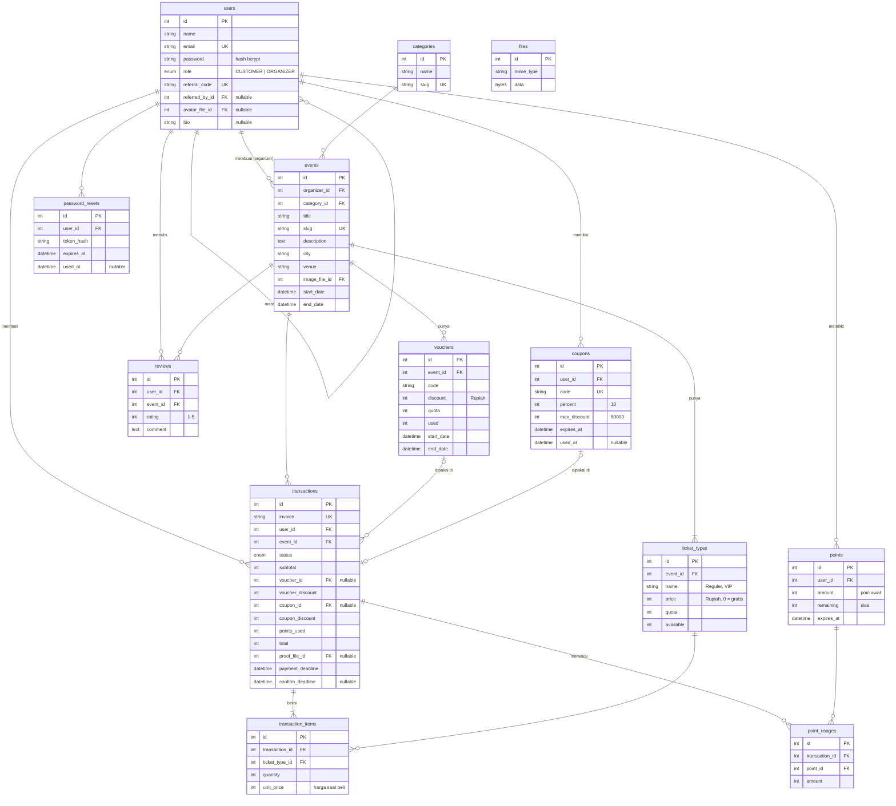

# 03 — Desain Database

## 1. ERD



Semua tabel juga punya `created_at` (dan `updated_at` jika datanya bisa diubah). Tidak saya tulis di diagram supaya tidak terlalu ramai.

## 2. Penjelasan keputusan desain

**Kenapa poin disimpan per baris, bukan satu kolom `saldo` di tabel user?**
Karena setiap tambahan poin punya tanggal kedaluwarsa sendiri (BR-08). Dengan per baris:
- saldo = `SUM(remaining) WHERE expires_at > now()`,
- poin kedaluwarsa otomatis tidak terhitung tanpa perlu job penghapus.

**Kenapa ada tabel `point_usages`?**
Untuk rollback yang tepat. Jika transaksi memakai 15.000 poin yang diambil dari dua baris berbeda, tabel ini mencatat "baris A dipakai 10.000, baris B dipakai 5.000". Saat rollback, angka itu dikembalikan ke baris yang sama.

**Kenapa `unit_price` disimpan di `transaction_items`?**
Organizer bisa mengubah harga tiket setelah ada yang membeli. Harga di transaksi harus tetap harga saat pembelian.

**Kenapa potongan voucher/kupon disimpan sebagai angka di transaksi?**
Sama alasannya: riwayat transaksi tidak boleh berubah walaupun voucher diedit. Selain itu, laporan pendapatan cukup membaca `total`.

**Kenapa `available` terpisah dari `quota`?**
`quota` = kapasitas awal, `available` = sisa saat ini. Jumlah terjual = `quota − available`, berguna untuk statistik.

## 3. Constraint dan index

| Tabel | Constraint / index | Tujuan |
|---|---|---|
| users | UNIQUE(email), UNIQUE(referral_code) | Tidak ada email atau kode ganda |
| vouchers | UNIQUE(event_id, code) | Kode voucher unik per acara |
| reviews | UNIQUE(user_id, event_id) | BR-16, satu ulasan per acara |
| transactions | INDEX(status, payment_deadline), INDEX(status, confirm_deadline) | Query job otomatis tetap cepat |
| events | INDEX(start_date), INDEX(category_id), INDEX(city) | Filter di halaman jelajah |
| points | INDEX(user_id, expires_at) | Hitung saldo |

## 4. Status transaksi (enum)

```
WAITING_PAYMENT | WAITING_CONFIRMATION | DONE | REJECTED | EXPIRED | CANCELED
```
