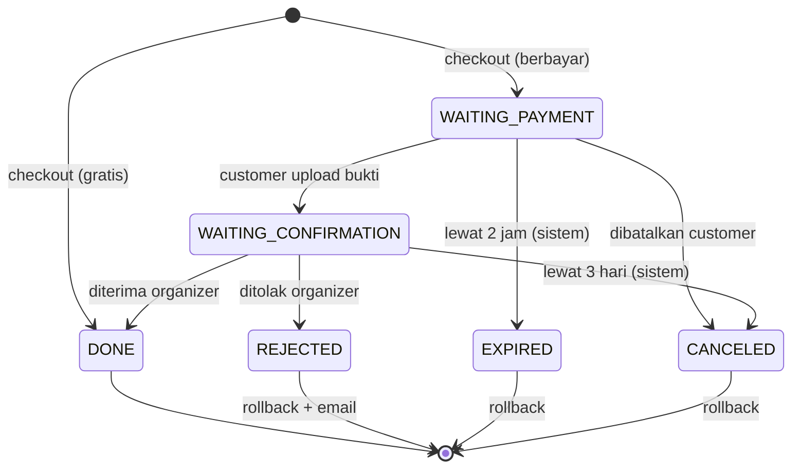
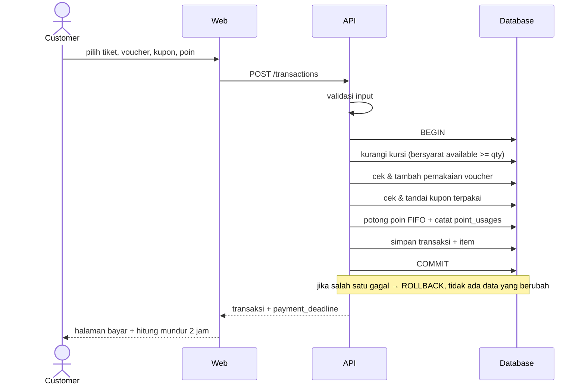
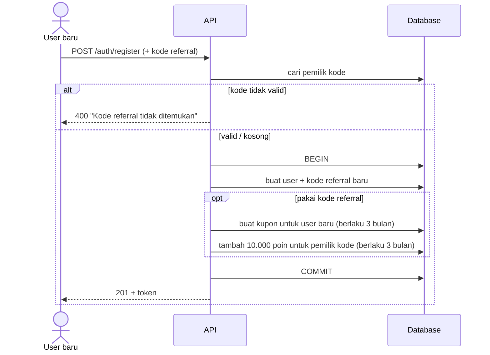

# 04 — Alur Proses

## 1. Siklus hidup transaksi



Perubahan status hanya boleh mengikuti panah di atas. Contoh: transaksi `EXPIRED` tidak bisa diterima organizer. Aturan ini dicek di service, jadi request yang tidak sah ditolak.

## 2. Checkout



Harga dihitung ulang di server dari data database. Harga yang dikirim browser diabaikan.

## 3. Rollback (expired / canceled / rejected)

Satu fungsi `releaseTransaction(tx)` dipakai di keempat kasus (expired oleh sistem, cancel oleh customer, auto-cancel oleh sistem, reject oleh organizer), jadi logikanya hanya ditulis sekali dan dites sekali:

```
BEGIN
  ubah status (hanya jika status lama masih sesuai)
  available ticket_types += quantity     (per item)
  vouchers.used -= 1                      (jika pakai voucher)
  coupons.used_at = NULL                  (jika pakai kupon)
  points.remaining += amount              (per point_usages)
COMMIT
```

"Hanya jika status lama masih sesuai" mencegah rollback dobel. Misalnya scheduler dan organizer memproses transaksi yang sama di waktu bersamaan: hanya satu yang berhasil mengubah status, yang lain tidak melakukan apa-apa.

## 4. Registrasi dengan referral



## 5. Lupa password

1. User mengisi email di halaman "Lupa password".
2. API membuat token acak, menyimpan **hash**-nya (bukan token asli) dengan masa berlaku 1 jam, lalu mengirim link `/reset-password?token=...` ke email.
3. API selalu menjawab "Jika email terdaftar, link sudah dikirim", supaya orang lain tidak bisa mengecek email mana yang terdaftar.
4. User membuka link, mengisi password baru, lalu token ditandai terpakai.

## 6. Halaman per peran

| Halaman | Guest | Customer | Organizer |
|---|:-:|:-:|:-:|
| Beranda, jelajah, detail acara, profil organizer | ✓ | ✓ | ✓ |
| Login, register, lupa password | ✓ | | |
| Checkout, pembayaran, tiket saya, poin & kupon | | ✓ | |
| Tulis ulasan | | ✓ | |
| Profil & ganti password | | ✓ | ✓ |
| Dashboard, kelola acara, voucher, transaksi, peserta, statistik | | | ✓ |
